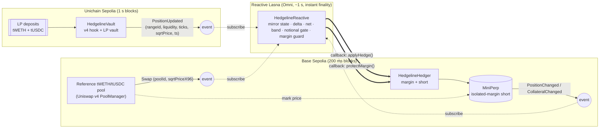
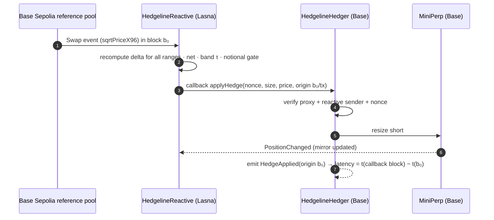

<h1 align="center">Hedgeline</h1>
<p align="center"><b>The LP hedge that never sleeps.</b><br/>
Delta-neutral Uniswap v4 liquidity with a <i>real</i> on-chain short, kept in sync across chains every second by a Reactive contract — no keeper, no bot, no server.</p>

<p align="center">
  
  
  
  
  
  
</p>

<p align="center">
  <a href="TODO">🎥 Demo video (&lt;3 min)</a> ·
  <a href="TODO">🖥️ Live dashboard</a> ·
  <a href="#judge-runbook-5-minute-check">✅ Judge runbook</a> ·
  <a href="#full-loop-proof-transactions">🔗 Proof transactions</a>
</p>

---

## The 30-second version

Liquidity providers on Uniswap quietly lose money to arbitrageurs every time the price moves. The known fix is to hold a **short perpetual** next to the LP position so the price risk cancels out — a *delta-neutral* LP.

The hard part is keeping that short the right size **while the market moves**, across two chains, without a bot.

Hedgeline does it with one Reactive contract on Reactive Omni that:

1. **Watches** the LP vault on **Unichain Sepolia** *and* the live ETH price on **Base Sepolia** (200 ms blocks).
2. **Computes** the vault's exact exposure itself — even when nobody is trading the LP's pool.
3. **Fires** a callback that opens or resizes a **real short** on an on-chain perp market on Base Sepolia.
4. **Guards** that short's margin, de-risking before it can be liquidated.

Every step is an on-chain transaction you can click through, and every hedge records its origin event, so **end-to-end latency is measured from chain data**, not claimed.

---

## Table of contents

- [The problem](#the-problem)
- [The solution](#the-solution)
- [What makes Hedgeline different](#what-makes-hedgeline-different)
- [Why this only works on Reactive Omni](#why-this-only-works-on-reactive-omni)
- [Architecture](#architecture)
- [How it works, step by step](#how-it-works-step-by-step)
- [The math](#the-math)
- [Latency: what one second buys](#latency-what-one-second-buys)
- [Contracts](#contracts)
- [Tech stack](#tech-stack)
- [Live on testnet](#live-on-testnet)
- [Full-loop proof transactions](#full-loop-proof-transactions)
- [Judge runbook (5-minute check)](#judge-runbook-5-minute-check)
- [How it's tested](#how-its-tested)
- [Run it locally](#run-it-locally)
- [Deploy it yourself](#deploy-it-yourself)
- [Repository layout](#repository-layout)
- [Security model](#security-model)
- [Honest limitations](#honest-limitations)
- [Roadmap](#roadmap)
- [Judging criteria map](#judging-criteria-map)
- [Glossary](#glossary)
- [References](#references)
- [License](#license)

---

## The problem

### LPs lose money even when nothing goes wrong

An LP deposits two assets, say ETH and USDC, so traders can swap between them. When ETH goes up, the pool sells ETH. When ETH goes down, the pool buys it. Arbitrageurs sit on the other side of every one of those rebalances and keep a small, near-certain profit each time.

Researchers named and measured this loss: **loss-versus-rebalancing (LVR)**. It grows with the square of volatility, at a rate of `σ²/8` of pool value per unit time (Milionis et al., 2022). For a volatile pair it often exceeds the fees the LP earns.

### The fix exists, but the plumbing doesn't

The textbook answer is to **hedge**: hold a short perpetual sized to the LP position's exposure (its *delta*), so the price risk cancels. In practice that means three hard problems:

1. **Delta moves continuously.** A concentrated-liquidity position's exposure changes with every price tick, so the hedge must be resized again and again.
2. **The pool and the perp live on different chains.** Something has to watch one chain and act on another.
3. **Today that "something" is a bot.** An off-chain keeper with a hot key, a server, uptime risk and an operator you must trust. When it lags or goes down during a fast move, which is exactly when hedging matters, the LP eats the loss.

### Hooks can't fix it alone

A Uniswap v4 hook only runs when someone touches the pool. If ETH moves 4% on other venues and nobody trades your pool for a minute, the hook never wakes up and the hedge goes stale. **The moment the hedge matters most is the moment the hook is asleep.**

---

## The solution

Hedgeline splits the job across three places, each doing what it's best at:

| Where | Component | Job |
|---|---|---|
| **Unichain Sepolia** | `HedgelineVault` (v4 hook + LP vault) | Holds LP liquidity in managed ranges, reports exact position state on every change |
| **Reactive Lasna** | `HedgelineReactive` | Watches both chains, computes delta, decides when and how much to hedge, protects margin |
| **Base Sepolia** | `HedgelineHedger` + `MiniPerp` | Holds hedge margin and the real short; applies callbacks; reports position changes |

There is no off-chain process anywhere in the hedging loop. The dashboard is read-only, and the demo scripts only create market activity.

---

## What makes Hedgeline different

| | Typical delta-neutral LP | Hedgeline |
|---|---|---|
| **Who resizes the hedge** | Off-chain keeper bot with a hot key | A Reactive contract — no server, no operator key in the loop |
| **When it rehedges** | When the bot polls, or when the pool trades | On pool changes **and** on external price moves, even while the pool is quiet |
| **Which delta it hedges** | Delta at the pool's last traded price | Delta at the **external** price — where arbitrage is about to push the pool |
| **Where decisions live** | Off-chain script | On-chain: mirrored state, delta math, netting, band, notional gate, margin guard |
| **Liquidation safety** | Usually unmonitored or bot-dependent | Built-in margin-guard loop that steps the hedge down before liquidation |
| **Proof of speed** | Rarely measured | Every hedge records its origin event; latency is computed from chain data |

---

## Why this only works on Reactive Omni

**Why Reactive.** The hedge must be cross-chain *and* automatic. A reactive contract subscribes to events on Unichain and Base and sends transactions to Base by itself. Without it you'd need a trusted keeper bot, which is the exact thing that breaks during volatility.

**Why Omni.** A hedge is only as good as its lag. On the previous ~7 s Reactive blocks, a delta-neutral position could drift unhedged for several seconds per update during a fast move. Omni's ~1 s blocks with instant finality make the loop short enough to track a fast market. We measure this rather than assert it — see [Latency](#latency-what-one-second-buys).

**Would it be simpler without Reactive?** Only by adding a centralized bot. Every piece of decision logic lives in the reactive contract, so removing Reactive removes the product.

---

## Architecture



### Three subscriptions, two callbacks

| # | Subscription (origin) | What the reactive contract does |
|---|---|---|
| S1 | `HedgelineVault.PositionUpdated` on Unichain Sepolia | Updates its mirror of each managed range (liquidity, ticks); recomputes delta |
| S2 | `PoolManager.Swap` for the reference pool on Base Sepolia (filtered by `poolId`) | Updates the external price; recomputes delta for every range **even if the Unichain pool is quiet**; re-checks margin ratio |
| S3 | `MiniPerp.PositionChanged` / `CollateralChanged` on Base Sepolia | Updates its mirror of the short (size, entry, collateral) for the margin guard |

| Callback (destination: Base Sepolia) | Fired when |
|---|---|
| `HedgelineHedger.applyHedge(...)` | Net target hedge differs from the last sent target by more than band `τ`, **and** the change exceeds the minimum notional |
| `HedgelineHedger.protectMargin(...)` | Margin ratio, computed from the mirrored short and the live price, falls below the warning or critical level |

---

## How it works, step by step

1. **Deposit.** An LP deposits tWETH and tUSDC into `HedgelineVault`, which adds liquidity to its managed ranges on the Unichain v4 pool. The vault emits `PositionUpdated(rangeId, liquidity, tickLower, tickUpper, sqrtPriceX96, nonce, timestamp)`.
2. **Mirror.** `HedgelineReactive` on Lasna receives the event (S1) and stores each range's liquidity and ticks in its own state.
3. **Price moves elsewhere.** A trade on the Base Sepolia reference pool makes the PoolManager emit `Swap` (S2). The reactive contract reads the new `sqrtPriceX96` and recomputes the exact delta of every mirrored range at that price.
4. **Decide.** It sums the target hedge across all ranges (netting), compares it with the last target it sent, and checks:
   - `|target − lastTarget| > τ` (rehedge band), and
   - `|target − lastTarget| × price > minNotional` (don't pay gas for dust).
5. **Act.** If both pass, it requests a callback to `HedgelineHedger.applyHedge(...)` on Base Sepolia. The payload carries a monotonic nonce, the target size, the price used, and the **origin event's chain, block number and transaction hash**.
6. **Execute.** The hedger accepts the call only through Reactive's callback proxy and only from our reactive contract, rejects stale nonces, then opens or resizes the short on `MiniPerp`. It emits `HedgeApplied(nonce, targetSize, originChainId, originBlock, originTx)`. **That event plus the origin block is the latency proof.**
7. **Guard.** On every price event, the reactive contract recomputes the short's margin ratio from its mirror (S3). If it drops toward liquidation, it fires `protectMargin(...)`, which lowers the hedge ratio or adds collateral from the hedger's reserve.
8. **Quiet market.** If nothing trades on Unichain but the price moves on Base, steps 3 to 7 still run. This is the case a hook-only design misses.



---

## The math

### 1. Exact delta of a concentrated-liquidity range

For liquidity `L` in range `[Pₐ, P_b]` at price `P`, the amount of the volatile asset the range holds is:

```
x(P) = L · (1/√P − 1/√P_b)          for Pₐ ≤ P ≤ P_b
x(P) = L · (1/√Pₐ − 1/√P_b)          for P < Pₐ      (all in the volatile asset)
x(P) = 0                              for P > P_b     (all in the stable asset)
```

`x(P)` is the range's **delta**. Hedgeline computes it inside the reactive contract from the mirrored `L` and ticks plus the **external** price.

**Why the external price.** The LP's holdings only change when someone trades the pool, but once the true price has moved, arbitrage *will* move the pool there. Hedging the delta at the external price closes the exposure before the arbitrageur realizes it, rather than after.

### 2. Target hedge, netted across ranges

```
target = h · Σᵢ xᵢ(P)
```

`h` is the hedge ratio, default `h = 0.65` (Hane, 2026). A partial hedge removes most price-risk variance while keeping the short much further from liquidation than a full hedge. `h` is configurable and is lowered automatically by the margin guard.

### 3. When to rehedge

```
rehedge  ⇔  |target − lastTarget| > τ   AND   |target − lastTarget| · P > minNotional
```

The band `τ` stops the system from trading on noise. The notional gate stops it from spending gas on dust.

### 4. Margin guard

```
marginRatio = (collateral + unrealizedPnL + funding) / (|size| · markPrice)

marginRatio < m_warn   → protectMargin(STEP_DOWN): h ← h − Δh, or top up from reserve
marginRatio < m_crit   → protectMargin(CUT):       h ← h_floor immediately
```

`funding` is the short's accrued funding from `MiniPerp`'s cumulative funding index (positive when the rate pays shorts).

### 5. Why hedging matters: LVR

```
LVR rate = σ² / 8          (per unit of pool value per unit time; Milionis et al., 2022)
```

The hedge doesn't remove LVR from the pool. It neutralizes the LP's **price exposure**, so what remains is fee income plus funding, minus hedging costs, instead of an unhedged directional bet.

---

## Latency: what one second buys

The buildathon asks for latency **across the full loop**. Every hedge callback carries the origin event's chain ID, block number and transaction hash, and the hedger emits them in `HedgeApplied`. `scripts/latency.ts` resolves the origin block's timestamp from the origin chain, the callback block's timestamp from Base Sepolia, and the Lasna reactive transaction in between.

**Measured loop:** origin event (Base swap *or* Unichain vault change) → Reactive Lasna → callback → short resized on Base Sepolia.

> Timestamp resolution differs by chain. `block.timestamp` is whole seconds everywhere, including Base Sepolia, where about five 200 ms blocks share one timestamp. Latency from chain timestamps is therefore reported ±1 s. `scripts/latency.ts` also reports an **estimated sub-second** figure from each block's position within its second (`timestamp + 0.2 s × position`), and a watcher script records wall-clock times from receipts as a cross-check.

| Trigger | Samples | Median | p95 | Max |
|---|---|---|---|---|
| Base price move → hedge resized | TODO | TODO | TODO | TODO |
| Unichain vault change → hedge resized | TODO | TODO | TODO | TODO |
| Price drop → protectMargin applied | TODO | TODO | TODO | TODO |

**Hedge-error comparison.** On the same recorded price path, `scripts/simulate-lag.ts` replays the hedge at the measured loop speed and at a simulated ~7 s loop (the pre-Omni block time), and reports average and worst unhedged exposure.

| Loop speed | Avg unhedged delta | Worst unhedged delta |
|---|---|---|
| Omni (measured) | TODO | TODO |
| ~7 s (simulated pre-Omni) | TODO | TODO |

---

## Contracts

| Contract | Chain | Role |
|---|---|---|
| `HedgelineVault` | Unichain Sepolia | v4 hook + LP vault. Owns the managed liquidity ranges, issues LP shares, blocks direct liquidity on its pool, emits `PositionUpdated` with a monotonic nonce. Address mined for hook permission bits. |
| `HedgelineReactive` | Reactive Lasna | Reactive contract. Three subscriptions, mirrored range and short state, delta math, netting, band, notional gate, margin guard, callback requests. |
| `HedgelineHedger` | Base Sepolia | Callback contract (`AbstractCallback`). Authenticates proxy and sender, enforces nonces, clamps sizes, holds margin and reserve, drives `MiniPerp`, emits `HedgeApplied`. |
| `MiniPerp` | Base Sepolia | Minimal on-chain perp: one ETH-USD market, isolated margin in tUSDC, mark price from the Base reference pool, funding index, maintenance-margin liquidation. |
| `DeltaMath` (library) | shared | Exact concentrated-liquidity delta, cross-checked in tests against Uniswap's `SqrtPriceMath.getAmount0Delta`. |
| Reference pool | Base Sepolia | tWETH/tUSDC pool on the official Uniswap v4 PoolManager, used as the external price source and perp mark price. |

### The reactive contract (simplified)

```solidity
// Simplified for the README — see contracts/src/HedgelineReactive.sol.
contract HedgelineReactive is AbstractReactive {
    function react(LogRecord memory log_) external onlySystem {
        if (log_.topic0 == POSITION_UPDATED_TOPIC) _onVaultUpdate(log_);   // S1: Unichain
        else if (log_.topic0 == V4_SWAP_TOPIC)     _onPrice(log_);         // S2: Base
        else if (log_.topic0 == PERP_POSITION_TOPIC
              || log_.topic0 == PERP_COLLATERAL_TOPIC) _onPerp(log_);     // S3: Base
    }

    function _onPrice(LogRecord memory log_) internal {
        uint160 sqrtP = _decodeSqrtPrice(log_.data);
        _checkMargin(sqrtP, log_);                       // margin guard first
        int256 target = _netTarget(sqrtP);               // h · Σ xᵢ(P)
        if (_outsideBand(target) && _aboveNotional(target, sqrtP)) {
            _requestHedge(target, sqrtP, log_);          // SYSTEM.requestCallbackV_1_0(...)
        }
    }
}
```

---

## Tech stack

| Layer | Technology |
|---|---|
| Automation | **Reactive Network Omni** (Lasna testnet), `reactive-lib-omni`, CometBFT ~1 s blocks, instant finality |
| AMM | **Uniswap v4** (`v4-core`, `v4-periphery`) on **Unichain Sepolia** and **Base Sepolia** |
| Hedge venue | `MiniPerp` on **Base Sepolia** (200 ms blocks) |
| Contracts | Solidity, **Foundry** (forge, cast, anvil), Solady |
| Scripts | TypeScript, **viem**, Node.js ≥ 22.18 (native TypeScript, no build step) |
| Dashboard | Next.js, wagmi, viem, Recharts (read-only, no wallet needed to view) |
| CI | GitHub Actions: `forge build --sizes`, `forge test` |

---

## Live on testnet

| Contract | Chain (id) | Address |
|---|---|---|
| `HedgelineVault` | Unichain Sepolia (1301) | `TODO` |
| `HedgelineReactive` | Reactive Lasna (5318007) | `TODO` |
| `HedgelineHedger` | Base Sepolia (84532) | `TODO` |
| `MiniPerp` | Base Sepolia (84532) | `TODO` |
| Reference pool id | Base Sepolia (84532) | `TODO` |
| tWETH / tUSDC | Unichain Sepolia + Base Sepolia | `TODO` |

Explorers: [Reactscan (Lasna)](https://lasna.reactscan.net/) · [Uniscan (Unichain Sepolia)](https://sepolia.uniscan.xyz/) · [BaseScan (Base Sepolia)](https://sepolia.basescan.org/)

---

## Full-loop proof transactions

Each row is one complete loop: origin event → reactive transaction → callback → state change.

| # | Scenario | Origin tx | Reactive tx (Lasna) | Callback tx | Latency |
|---|---|---|---|---|---|
| 1 | LP deposit on Unichain opens the first short | TODO | TODO | TODO | TODO |
| 2 | Price move on Base, **zero swaps on Unichain**, resizes short | TODO | TODO | TODO | TODO |
| 3 | Small move inside band `τ` → **no hedge** (event received, callback skipped) | TODO | TODO | — | — |
| 4 | Two ranges net into a single resize | TODO | TODO | TODO | TODO |
| 5 | Sharp move pushes margin to warning → `protectMargin` cuts the hedge ratio | TODO | TODO | TODO | TODO |

Scenario 3 matters as much as the others. It shows the reactive contract making a decision, not just forwarding.

---

## Judge runbook (5-minute check)

1. **Open the dashboard** at `TODO`. No wallet needed. It shows live vault delta, current short size, margin ratio and the latency feed.
2. **Click any row** in [Full-loop proof transactions](#full-loop-proof-transactions). Each opens the origin tx, the Lasna reactive tx and the destination callback.
3. **Read the hedge state directly:**
   ```bash
   cast call <HEDGER_ADDRESS> "hedgeState()(int256,uint256,uint64)" --rpc-url https://sepolia.base.org
   # → (shortSize, collateral, lastNonce)
   ```
4. **Trigger a loop yourself** (needs Base Sepolia ETH):
   ```bash
   cd scripts && npm i
   npm run move-price -- --pct 2      # swaps on the Base reference pool
   npm run watch                       # prints origin → reactive → callback with timestamps
   ```
5. **Run the tests:** `forge test` from the repo root.

---

## How it's tested

- **Unit tests** for `DeltaMath`, band logic, notional gate, nonce handling, margin thresholds and `MiniPerp` accounting.
- **Delta cross-check:** `DeltaMath` is asserted equal to Uniswap's `SqrtPriceMath.getAmount0Delta` across the tick range, and fuzzed.
- **In-process loop simulation:** recorded origin logs are fed to `react()` as the system contract would deliver them; requested callbacks are delivered through a mock callback proxy that injects the reactive contract's address as the first argument. This tests the whole decision loop without a live network.
- **Invariant tests:** the hedger never applies a stale nonce, `|short| ≤ maxShortWad`, no single callback moves the short by more than `maxStepWad`, and collateral never goes negative without a liquidation event.
- **Fork tests** against the live Unichain Sepolia and Base Sepolia PoolManagers.
- **Totals:** TODO tests, TODO suites. CI runs on every push.

```bash
forge test                                   # all offline tests
forge test --match-path 'contracts/test/fork/*' -vvv   # fork tests (needs RPC env vars)
forge test --gas-report
```

---

## Run it locally

**Prerequisites:** [Foundry](https://book.getfoundry.sh), Node.js ≥ 22.18.

```bash
git clone --recurse-submodules https://github.com/TODO/hedgeline.git
cd hedgeline
forge build --sizes
forge test

# dashboard (reads the live testnet deployment)
cd frontend
npm install
cp .env.example .env.local
npm run dev                     # http://localhost:3000
```

---

## Deploy it yourself

```bash
cp .env.example .env
# PRIVATE_KEY, UNICHAIN_SEPOLIA_RPC, BASE_SEPOLIA_RPC, LASNA_RPC=https://lasna-rpc.rnk.dev/
```

Get testnet lREACT by sending Sepolia or Base Sepolia ETH to the [Lasna faucet](https://dev.reactive.network/reactive-mainnet#get-testnet-react). Callback proxy addresses are listed in [Origins & Destinations](https://dev.reactive.network/origins-and-destinations#testnet-chains).

```bash
# 1. Base Sepolia: test tokens (CREATE2, same addresses as on Unichain), reference pool, MiniPerp
forge script contracts/script/01_DeployBase.s.sol --rpc-url $BASE_SEPOLIA_RPC --broadcast

# 2. Unichain Sepolia: test tokens (same CREATE2 salt; script reverts if addresses or token order differ), vault hook (address mined), pool + initial liquidity
forge script contracts/script/02_DeployUnichain.s.sol --rpc-url $UNICHAIN_SEPOLIA_RPC --broadcast

# 3. Reactive Lasna: reactive contract (subscribes in its constructor), funded with lREACT
forge script contracts/script/03_DeployReactive.s.sol --rpc-url $LASNA_RPC --broadcast

# 4. Base Sepolia: hedger (callback proxy + reactive address), fund margin + callback fees
forge script contracts/script/04_DeployHedger.s.sol --rpc-url $BASE_SEPOLIA_RPC --broadcast

# 5. Lasna: point the reactive contract at the hedger
forge script contracts/script/05_Wire.s.sol --rpc-url $LASNA_RPC --broadcast
```

Timers, cooldowns and funding on Base Sepolia use `block.timestamp`, never block counts, because Base Sepolia produces 200 ms blocks.

---

## Repository layout

```
hedgeline/
├── contracts/
│   ├── src/
│   │   ├── HedgelineVault.sol
│   │   ├── HedgelineReactive.sol
│   │   ├── HedgelineHedger.sol
│   │   ├── MiniPerp.sol
│   │   └── libraries/DeltaMath.sol
│   ├── script/            # 01–05 deploy scripts, HookMiner
│   └── test/              # unit, fuzz, invariant, loopsim/, fork/
├── scripts/               # move-price.ts, watch.ts, latency.ts, simulate-lag.ts
├── frontend/              # read-only dashboard
├── assets/                # banner, diagrams
├── docs/
│   ├── LATENCY.md         # method + raw samples
│   └── DEMO.md            # video script
└── README.md
```

---

## Security model

- **Authenticated callbacks.** `HedgelineHedger` inherits `AbstractCallback` and guards every callback with both `onlyServiceProvider` (the call came through Reactive's callback proxy) and `onlyCallbackSender` (the injected sender is our `HedgelineReactive`).
- **Authenticated reactive input.** `react()` is `onlySystem`, so only Reactive's system contract can deliver logs, and every subscription is pinned to a specific chain, contract and topic.
- **Replay and ordering protection.** Monotonic nonces are checked on the destination; targets are absolute sizes, so a late callback can never stack on top of a newer one.
- **Bounded actions.** The hedger clamps every requested size to `|target| ≤ maxShortWad` and every change to `|target − current| ≤ maxStepWad`, so a bad payload can't open an outsized short.
- **No swap-curve changes.** The vault hook doesn't alter pricing. Traders use a standard v4 pool.
- **Partial hedge by default.** `h = 0.65` plus the margin guard keeps the short away from liquidation.
- **Pause switch.** The owner can pause new hedges. Closing the short is always allowed.
- **Testnet only.** This code is not audited. Don't deploy it with real funds.

---

## Honest limitations

- **`MiniPerp` is our own venue.** It's a minimal perp market on Base Sepolia, a chain Lasna delivers callbacks to, so the hedge leg runs live. It has real on-chain margin accounting but not organic liquidity. The hedger talks to it through an `IHedgeVenue` interface, so a production venue can be swapped in.
- **Testnet price activity is scripted.** Testnet pools have no organic flow, so scripts move prices. Every resulting loop is still a real on-chain transaction chain.
- **Reactive reacts after the event.** A hedge follows the price move that triggered it. The goal is to shrink that lag, not remove it.
- **Funding is accounted, not yet distributed.** `MiniPerp` accrues funding to the short; routing it back to LPs on Unichain is roadmap work.
- **Spot mark price.** The perp marks to the reference pool's current price, which is fine on testnet but would need a manipulation-resistant oracle in production.

---

## Roadmap

| Stage | Status |
|---|---|
| First full loop (Unichain → Lasna → Base) | TODO |
| `MiniPerp` + hedger opening real shorts | TODO |
| External-price trigger (quiet-pool rehedge) | TODO |
| Netting across ranges + notional gate | TODO |
| Margin-guard loop | TODO |
| Latency measurement + Omni vs ~7 s comparison | TODO |
| Dashboard + demo video | TODO |
| Next: production perp venue adapter, funding returned to LPs, directional dynamic fee in the hook, manipulation-resistant mark price | Planned |

---

## Judging criteria map

| Criterion | Where to look |
|---|---|
| **Execution** | [Full-loop proof transactions](#full-loop-proof-transactions): origin, reactive and callback hashes for five scenarios |
| **Integration** | [How it works](#how-it-works-step-by-step): the reactive contract mirrors state, computes delta, nets, gates and guards margin. It *is* the product, not a relay. |
| **Usefulness** | [The problem](#the-problem): LP price exposure hedged with no trusted bot and no stalling when the pool is quiet |
| **Craft** | Tests, CI, this README, [Deploy it yourself](#deploy-it-yourself), [`docs/LATENCY.md`](docs/LATENCY.md), demo video |

---

## Glossary

| Term | Meaning |
|---|---|
| **LP** | Liquidity provider: someone who deposits two assets into a pool and earns trading fees |
| **LVR** | Loss-versus-rebalancing: what an LP loses to arbitrageurs as the price moves |
| **Delta** | How much a position's value changes when the price changes |
| **Delta-neutral** | A combined position whose value barely changes with price |
| **Perp** | Perpetual future: a leveraged bet on price with no expiry |
| **Funding** | Periodic payment between perp longs and shorts that ties the perp price to the spot price |
| **Hook** | Uniswap v4 plug-in that runs code at fixed points in a pool's life |
| **Reactive contract** | A contract on Reactive Network that subscribes to events on other chains and sends transactions in response |
| **Callback** | The transaction a reactive contract sends to a destination chain |

---

## References

1. Milionis, Moallemi, Roughgarden, Zhang (2022). *Automated Market Making and Loss-Versus-Rebalancing.* The `σ²/8` LVR rate.
2. Hane (2026). *Optimal Hedge Ratio for Delta-Neutral Liquidity Provision under Liquidation Constraints.* [arXiv:2603.19716](https://arxiv.org/abs/2603.19716). Basis for the default `h ≈ 0.65`.
3. Reactive Network. [Developer docs](https://dev.reactive.network/) · [Reactive Contracts](https://dev.reactive.network/reactive-contracts) · [Callback Contracts](https://dev.reactive.network/callback-contracts) · [Origins & Destinations](https://dev.reactive.network/origins-and-destinations).
4. Uniswap v4. [Documentation](https://docs.uniswap.org/contracts/v4/overview).

---

## License

Hedgeline's own code is MIT. See [LICENSE](LICENSE).

Dependencies keep their upstream licenses and are pulled in as git submodules, not copied into this repo. In particular, [`reactive-lib-omni`](https://github.com/Reactive-Network/reactive-lib-omni) is published `UNLICENSED` upstream, so it is used only as a submodule and never vendored.

<p align="center"><b>Hedgeline</b> — your hedge keeps up, even when your pool sleeps.</p>
